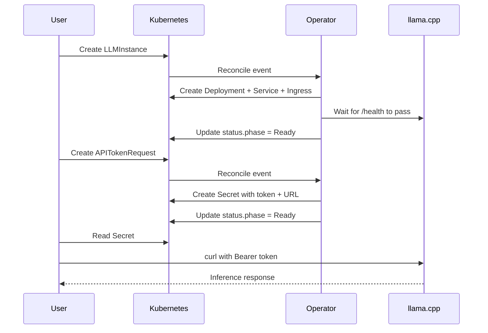

# Resource Guide

The operator manages two custom resources in the `llm.privatellms.msp` API group. This page provides a practical overview with examples.

---

## LLMInstance

**What it does:** Requests a private llama.cpp inference endpoint. The operator turns it into a Deployment, Service, Ingress, and Traefik middlewares.

**Key fields:**

| Field | Description | Default |
|-------|-------------|---------|
| `spec.model` | Model to deploy (`tinyllama`, `phi-2`, `gemma-3-1b-it`, `gemma-3-4b-it`, `gemma-3-12b-it`, `qwen3-4b`) | `tinyllama` |
| `spec.replicas` | Number of inference pods | `1` |
| `spec.dnsPolicy` | Pod resolver policy. Set `Default` only when the cluster DNS service cannot resolve the external model source. | `ClusterFirst` |
| `spec.clusterRef.kubeconfigSecretName` | Optional kubeconfig Secret for BYOC mode. When omitted, the instance runs as-a-Service on the provider-managed cluster. | unset |

| `spec.resources.cpu.requestMilli` / `limitMilli` | CPU request and limit in millicores. Supply both; each must be 100 to 16000, and request must not exceed limit. | Model defaults |
| `spec.resources.memory.requestMiB` / `limitMiB` | Memory request and limit in MiB. Supply both; each must be 128 to 65536, and request must not exceed limit. | Model defaults |
| `spec.contextSize` | Integer from 1024 to 131072, passed as `--ctx-size`. The model can impose a lower limit. | Model/server default |
| `spec.parallelSlots` | Integer from 1 to 16, passed as `--parallel`. | Server default |

**What you read back:**

| Field | Description |
|-------|-------------|
| `status.phase` | `Provisioning` or `Ready` |
| `status.slug` | Informational operator-selected slug; tenant changes do not select routing |
| `status.slugSource` | Whether the policy preserves a legacy name or derives the current identity |
| `status.endpoint` | Public URL (e.g., `https://host/llm/<slug>`) |
| `status.conditions[].type=Ready` | Detailed readiness information |

### Minimal Example

```yaml
apiVersion: llm.privatellms.msp/v1alpha1
kind: LLMInstance
metadata:
  name: my-llm
spec:
  model: tinyllama
```

### Scaled Example

```yaml
apiVersion: llm.privatellms.msp/v1alpha1
kind: LLMInstance
metadata:
  name: production-llm
spec:
  model: gemma-3-4b-it
  replicas: 3
```

### Model server resources and context

These settings apply to each inference pod in both provider and BYOC mode.
The model download container keeps its existing resource settings.
Omit CPU or memory to keep that model's existing request and limit.
Remove an override to restore the model defaults. Updates change existing deployments.

The provider controls ceilings through the operator flags below.
Tenants cannot raise these values through LLMInstance.
An excessive setting produces phase `Rejected` and `Ready=False`, with reason `ModelSettingsRejected`.
The operator does not apply the rejected workload change.
An existing deployment retains its previous settings until an allowed update replaces them.
Correct the instance settings or ask the provider to raise the ceiling.

| Operator flag | Helm value under `modelServerCeilings` | Default policy (`0`) |
| --- | --- | --- |
| `--max-model-cpu-milli` | `cpuMilli` | Existing CPU request/limit; Qwen: 500m/1800m |
| `--max-model-memory-mib` | `memoryMiB` | Existing memory request/limit; Qwen: 4096/7168 MiB |
| `--max-context-size` | `contextSize` | Existing explicit model context; Qwen: 8192 |
| `--max-parallel-slots` | `parallelSlots` | Existing model slot setting, or the pinned server default of 4 |

Zero is not an unlimited ceiling.
Models without an explicit CPU, memory, or context budget cannot receive an override for that budget until the provider sets a ceiling.
Their existing settings remain unchanged when the new instance fields are omitted.
Positive ceilings restrict both explicit settings and effective model defaults.
All four provider values must be nonnegative integers within the corresponding API maximum.
They set ceilings, not new workload defaults.
Provider policy applies before local and BYOC workload changes.

For example, the provider can permit six CPUs through Helm:

```yaml
modelServerCeilings:
  cpuMilli: 6000
  memoryMiB: 0
  contextSize: 0
  parallelSlots: 0
```

After the provider permits this budget, request six CPUs for Qwen:

```yaml
apiVersion: llm.privatellms.msp/v1alpha1
kind: LLMInstance
metadata:
  name: agentic-model
spec:
  model: qwen3-4b
  resources:
    cpu:
      requestMilli: 6000
      limitMilli: 6000
    memory:
      requestMiB: 4096
      limitMiB: 7168
  contextSize: 8192
  parallelSlots: 1
```

Without overrides, Qwen keeps its 500m CPU request, 1800m CPU limit, 4Gi memory request, and 7Gi memory limit.
Other models keep their existing settings. No new API field has a default. The provider ceilings must also permit an override.

Check node capacity and namespace quotas before you increase resources.
API bounds do not reserve cluster capacity or guarantee that the model can start.
A larger context can increase memory use. It does not extend the model's trained context or add tool support.
Measure startup slot size and prompt evaluation tokens per second.
Verify a complete chat and tool call within the caller's timeout before you claim acceptance.
The six-CPU example is an experiment, not a measured performance result.

These optional fields are available through the Kubernetes API and its published schema.
The Portal form does not supply them automatically.

### Common Operations

```sh
# List all instances
kubectl get llminstances -o wide

# Watch provisioning progress
kubectl get llminstance my-llm -w

# Scale an existing instance
kubectl patch llminstance my-llm --type=merge -p '{"spec":{"replicas":3}}'

# Change model (triggers rolling update)
kubectl patch llminstance my-llm --type=merge -p '{"spec":{"model":"gemma-3-1b-it"}}'

# Delete (cleans up Deployment, Service, Ingress, and Middlewares)
kubectl delete llminstance my-llm
```

### What Gets Created

For each `LLMInstance`, the operator creates:

| Resource | Name Pattern | Purpose |
|----------|-------------|---------|
| Deployment | `<name>-llama` | llama.cpp server pods with init container for model download |
| Service | `<name>-llama` | ClusterIP service on port 8000 |
| Ingress | `<name>-llama` | Routes `<PUBLIC_HOST>/llm/<slug>` to the service |
| Middleware | `<name>-llama-strip` | Traefik StripPrefix to remove `/llm/<slug>` |
| Middleware | `<name>-llama-auth` | Traefik ForwardAuth for bearer token validation |

### BYOC Example

In BYOC mode, the referenced Secret must live in the same namespace and contain
the target cluster kubeconfig under the `kubeconfig` key. SimpleCluster's
`<name>-kubeconfig` Secrets follow this contract.

```yaml
apiVersion: llm.privatellms.msp/v1alpha1
kind: LLMInstance
metadata:
  name: my-byoc-llm
spec:
  model: tinyllama
  clusterRef:
    kubeconfigSecretName: sc-cf-kubeconfig
```

The remote workload uses a `LoadBalancer` Service with plain HTTP on port `443`
and forwards traffic to the llama.cpp container on port `8000`.

---

## APITokenRequest

**What it does:** Mints a bearer token for an existing LLMInstance. The token is stored in a Kubernetes Secret.

**Key fields:**

| Field | Description | Required |
|-------|-------------|----------|
| `spec.instanceName` | Target LLMInstance (same namespace) | Yes |
| `spec.description` | Human-friendly note | No |

**What you read back:**

| Field | Description |
|-------|-------------|
| `status.phase` | `Pending` or `Ready` |
| `status.secretName` | Name of the Secret with credentials |

### Minimal Example

```yaml
apiVersion: llm.privatellms.msp/v1alpha1
kind: APITokenRequest
metadata:
  name: my-token
spec:
  instanceName: my-llm
```

### With Description

```yaml
apiVersion: llm.privatellms.msp/v1alpha1
kind: APITokenRequest
metadata:
  name: ci-pipeline-token
spec:
  instanceName: production-llm
  description: "Token for CI/CD integration tests"
```

### Retrieving Credentials

```sh
# Wait for token to be ready
kubectl wait apitokenrequest/my-token --for=jsonpath='{.status.phase}'=Ready --timeout=60s

# Get secret name
SECRET=$(kubectl get apitokenrequest my-token -o jsonpath='{.status.secretName}')

# Extract credentials
OPENAI_API_KEY=$(kubectl get secret "$SECRET" -o jsonpath='{.data.OPENAI_API_KEY}' | base64 -d)
OPENAI_API_URL=$(kubectl get secret "$SECRET" -o jsonpath='{.data.OPENAI_API_URL}' | base64 -d)

echo "API Key: $OPENAI_API_KEY"
echo "API URL: $OPENAI_API_URL"
```

### Generated Secret Structure

```yaml
apiVersion: v1
kind: Secret
metadata:
  name: my-token-token
  labels:
    app.kubernetes.io/name: llm-token
    llm.privatellms.msp/instance: my-llm
    llm.privatellms.msp/apitokenrequest: my-token
    llm.privatellms.msp/slug: aB3xK9mLp2Qz
    apeirora.eu/llm-api-compatibility: openai
type: Opaque
data:
  OPENAI_API_KEY: <base64-encoded-random-token>
  OPENAI_API_URL: <base64-encoded-endpoint-url>
```

> **Note:** The `apeirora.eu/llm-api-compatibility: openai` label makes it easy for other operators (like Chat UI) to discover LLM credentials.

---

## Typical End-to-End Flow



1. Create an `LLMInstance` -- the operator provisions the infrastructure
2. Wait for `status.phase` to become `Ready`
3. Create an `APITokenRequest` referencing the instance
4. Retrieve `OPENAI_API_KEY` and `OPENAI_API_URL` from the generated Secret
5. Call the API with `Authorization: Bearer <token>` (see [API Reference](api-reference.md))
